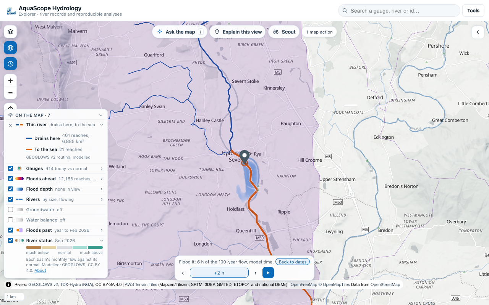
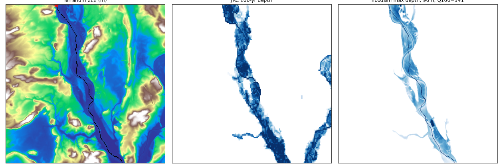
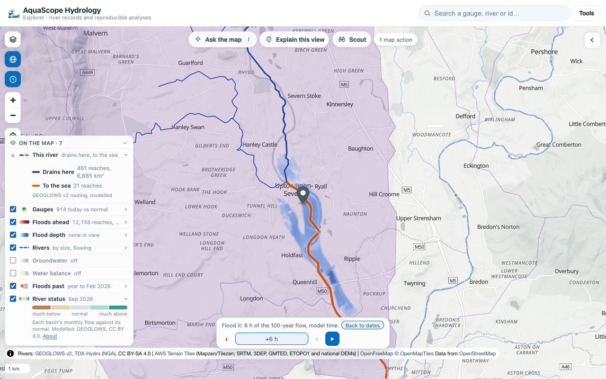

# Flood it: a screening flood from a river click (spike)

**Experimental, a spike for [#658](https://github.com/Rekin226/aquascope/issues/658).** Click a river reach,
press **Flood it** on its card, and the reach's 100-year flow (or the 2- or 10-year) pours in for six hours. The
water spreads over the terrain on your own GPU and the depth is drawn on the map, with the time bar on the model's
own clock. Nothing runs on a server.




It is a **screening flood**, never a design flood. The terrain has no bathymetry and vertical errors of metres,
the inflow is constant, there is no rain and no levee the terrain does not show. The card says so every time.

## What runs

- **Terrain.** The Terrarium tiles the hillshade already uses (`elevation-tiles-prod`, Mapzen/Tilezen joerd on AWS
  Open Data: SRTM, GMTED2010, ETOPO1 and national models; decoded as `R*256 + G + B/256 - 32768`), 512 x 512
  cells at zoom 12 centred on the click. A cell is about 38 m at the equator and 23.5 m at 52°N, so the grid is
  12 km to 20 km across.
- **The river.** The GEOGLOWS v2 river lines in view (the reach and every river of at least its Strahler order)
  are burnt in, one cell wide. The bank line is made non-increasing downstream (a running minimum), and the bed is
  that line minus a depth.
- **The channel depth** is the hydraulic-geometry rule of this spike: the depth at which a wide rectangular channel
  one cell wide carries the reach's 2-year flow (taken as bankfull) at normal depth by Manning's equation,
  `d = (n Q2 / (W S^(1/2)))^(3/5)`, with `n = 0.035`, `W` the cell size and `S` the network's bank drop (5th to
  95th percentile) over its extent, kept between 1e-4 and 1e-2. On the Severn at Upton this gives 5.5 m.
- **The flow.** The reach's return-period flows from the worker's forecast call: Log-Pearson III fitted to
  GEOGLOWS v2's simulated annual maxima since 1940 (daily flows). On the Severn reach 230567275 the 2-year flow is
  133 m³/s and the 100-year flow 341 m³/s. It goes into the burnt cell nearest the click.
- **Friction.** Manning's n of 0.035 in the channel and 0.06 on the flood plain, screening defaults within Chow's
  (1959) ranges, not calibrated.
- **The edges** of the grid are a free outfall: water that reaches them leaves, and is counted.

## The scheme

The local-inertial approximation of the shallow water equations used by LISFLOOD-FP: Bates, Horritt and Fewtrell
(2010), *J. Hydrol.* 387, 33-45, doi:10.1016/j.jhydrol.2010.03.027, in the q-centred form of de Almeida, Bates,
Freer and Souvignet (2012), *Water Resour. Res.* 48, W05528, doi:10.1029/2011WR011570. Depth `h` and bed `z` sit
at cell centres, unit discharge `q` (m²/s) on the faces. One step:

```
hf      = max(eta_l, eta_r) - max(z_l, z_r)                       (eta = z + h)
q_new   = [theta q + (1 - theta)/2 (q_left + q_right) - g hf dt (eta_r - eta_l)/dx]
          / [1 + g dt n^2 |q| / hf^(7/3)]                         (0 where hf <= 1 mm)
h_new   = h + dt/dx (q_in - q_out)  summed over the four faces,  + Q dt / dx^2 at the inflow cell
dt      = alpha dx / sqrt(g h_max)
```

with `alpha = 0.7` and `theta = 0.7`. The equations were checked against Shaw et al. (2021, *GMD* 14, 3577,
eqs. 18-19, the LISFLOOD-FP 8.0 paper) and Cozzolino et al. (2019, *Adv. Water Resour.* 133, 103422, eqs. 46-48),
which give those two coefficients (de Almeida et al. 2012; de Almeida and Bates 2013). `theta = 1` is the form of
Bates et al. (2010).

Depth never goes negative: when a cell's outgoing faces would take more than it holds in a step, they are scaled so
that it empties exactly. This keeps the volume exact, where clipping negative depths would create water.

One scheme, three implementations that are checked against each other:

| Where | What | Checked by |
| --- | --- | --- |
| `aquascope.floodsim` | numpy, float64: the checks, the JRC comparison | `tests/test_floodsim.py` |
| `explorer/src/floodsim-core.js` | JS, float64: the fallback worker | `explorer/tests/floodsim-core.test.mjs` runs the same grid as a Python fixture: the same step count, depths within 1 µm |
| `FLOODSIM_WGSL` in the same file | WebGPU compute shaders, float32, five passes a step, no read-back between steps | on the Severn grid against numpy: the same 9,579 wet cells after 6 h, mean depth difference 0.03 mm, largest 3 cm |

## The checks

| Check | Result |
| --- | --- |
| Still water over a bumpy bed with dry islands, closed and open edges | no cell moves by more than 1e-12 m in 10 minutes |
| Volume budget (final = initial + inflow - outflow), closed and open | relative error under 1e-12 (0 to 2e-16 seen) |
| Manning's normal depth on a 1/1000 plane, n = 0.05, q = 2 m²/s | 1.978 m against 1.995 m mid-reach (0.9%); the test allows 2% |
| Ritter's (1892) dam break, 1 m on a dry, flat, frictionless bed, at 30 s | relative L1 depth error 0.18 (0.177 to 0.185 for dx from 4 m to 0.5 m); the test allows 0.20 |

The dam break is the honest one. Without the advection term, the local-inertial scheme cannot follow a
supercritical front: at 30 s its front is 60 m past the dam where Ritter's is 188 m, and the depth at the dam is
0.59 m where Ritter's is 0.44 m. The error does not shrink as the grid is refined, so it is the approximation, not
the code. The literature says the same (de Almeida and Bates 2013, and Martins et al. 2016 as summarised by Cozzolino et al.
2019): use it for gradually varied, subcritical flow. Floods on flood plains are mostly that.

## Against the JRC 100-year depth

The JRC CEMS-GloFAS 100-year flood depth map (v2.1.2, 3 arc-seconds, CC BY 4.0, read from the Source Cooperative
mirror the Explorer's flood depth layer uses) at the Severn at Upton (reach 230567275), on the same 512 x 512 grid
(the nearest JRC pixel to each cell centre). For this comparison the run is the steady state a hazard map shows:
the 100-year flow (341 m³/s) poured in where the Severn enters the grid, the upstream edge walled, run for 96 hours
(the storage changed by under 1 cm anywhere between 48 h and 96 h). Cells are wet above 5 cm; the burnt channel is
left out.



| | the whole grid | within 1.5 km of the Severn |
| --- | --- | --- |
| cells wet in JRC | 35,224 | 26,835 |
| cells wet in Flood it | 24,163 | 23,704 |
| wet in both, as a share of wet in either (CSI) | 0.645 | 0.831 |
| share of JRC's wet cells Flood it wets | 0.661 | 0.855 |
| share of Flood it's wet cells JRC leaves dry | 0.036 | 0.032 |
| depth difference where both are wet (Flood it - JRC) | median -1.57 m, 10th to 90th percentile -3.0 to -0.2 m | the same |

Where they differ:

- **Other rivers.** Most of JRC's wet cells that Flood it misses are on the Avon in the east of the grid and a
  tributary in the south-west. Flood it pours water into one reach only; JRC floods every river at once.
- **Depth.** Flood it is shallower by about 1.6 m. The flows are not the same flood: the 341 m³/s is fitted to
  GEOGLOWS's daily flows, and JRC's maps come from its own LISFLOOD flows; the burnt channel carries more than JRC's
  channel may; neither has the Severn's real bathymetry. One reach is not a validation.
- **Six hours is not the steady state.** The Explorer's default run (6 hours from the click) wets 9,240 cells
  (CSI 0.26 against JRC on the whole grid): the flood is still spreading. A hazard-map comparison needs the long run,
  which on the GPU takes seconds.

## Speed

On the Severn grid (512 x 512 cells of 23.5 m, six hours of 341 m³/s, about 14,600 steps), headless Chrome 155 on
an Apple M4 Max, other jobs running at the same time:

| Engine | Grid | Steps a second | Six hours of flood |
| --- | --- | --- | --- |
| WebGPU, the laptop GPU (Metal) | 512 x 512 | about 32,800 | 0.45 s |
| WebGPU in the Explorer, with 25 frames read back and drawn | 512 x 512 | about 18,600 | 0.9 s to 1.2 s |
| WebGPU on SwiftShader (the CPU pretending to be a GPU) | 512 x 512 | 12.8 | about 19 min |
| JS on the CPU | 512 x 512 | 292 | about 50 s |
| JS on the CPU, the fallback's grid | 256 x 256 | 1,150 | 5.9 s |
| JS in the Explorer's worker, with 25 frames drawn | 256 x 256 | about 1,140 | 6.1 s |
| numpy (`aquascope.floodsim`) | 512 x 512 | about 140 | about 100 s |

Headless Chrome exposes WebGPU only with `--enable-unsafe-webgpu`: then it gets the real GPU (Metal), or SwiftShader
when ANGLE is forced to SwiftShader. With the Explorer's usual headless flags (`--use-angle=swiftshader`) there is
no adapter at all, and Flood it falls back to the worker. Most of a run's 30 seconds from the click are reading the
flows and the terrain, not the flood.

Without WebGPU the same run on the 256 x 256 grid (cells of 47 m, the channel burnt again on that grid) wets
4.69 km² after six hours, against 5.17 km² on the GPU's 512 x 512 grid:



## What the full feature needs

- **A choice of flows and inflows:** the forecast peak, a number, a hydrograph (a rising and falling flow, not a
  constant), and inflow where the river enters the grid as well as at the click; every river in view fed by its own
  flow, so a confluence floods like JRC's maps.
- **The mesh views** of #619 to #622: smooth depth, hazard H1 to H6, arrival time (the solver already tracks it in
  numpy), a drawn section, and the buildings, roads and people under the water (exposure), with the swipe to
  compare two runs.
- **The edges:** walls upstream, a normal-depth edge downstream, and a grid that follows the river rather than a
  square around the click.
- **Levees and breaches (#663):** raise or lower the burnt terrain under a drawn line and run again.
- **More checks:** the Portsmouth HEC-RAS sample and JRC at a few more places, with the page saying where the run
  differs from JRC.
- **The three faces:** an `aquascope flood` verb, an MCP tool and Ask-the-map's `flood_reach` action (the action
  type is already in the undo log).

## Licences

Terrain: Terrarium tiles on AWS Open Data (Mapzen/Tilezen joerd; see its attribution list). Rivers: GEOGLOWS v2
(TDX-Hydro, NGA, CC BY-SA 4.0). Flows: GEOGLOWS v2 retrospective simulation, CC BY 4.0. JRC flood depth: CEMS-GloFAS
v2.1.2, © European Union, CC BY 4.0, from N. Lebovits's Source Cooperative mirror.
