# Flood it: a screening flood of a river's valley

**Experimental** ([#658](https://github.com/Rekin226/aquascope/issues/658), part of
[#664](https://github.com/Rekin226/aquascope/issues/664)). Click a river reach and press **Flood it** on its card.
The valley floods at the reach's 100-year flow, every river in it fed at the same return period, and the depth is
drawn on the map as the water spreads, on your own GPU. Nothing runs on a server.

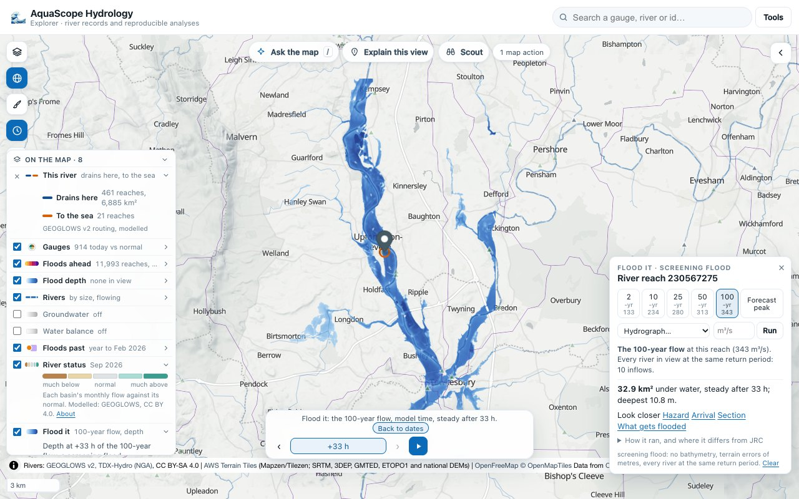

It is a **screening flood**, never a design flood. The terrain has no bathymetry and vertical errors of metres, the
channel is one cell wide, every river is at the same return period at once, and there are no defences the terrain
does not show. The panel says so every time.

## What you do

1. **Click a river, press Flood it.** The 100-year flow runs at once. The first frames appear within a second of the
   grid being ready; a run of about 400,000 cells settles in about 5 seconds on a laptop GPU. The camera then
   frames the water and the time bar steps through the run.
2. **Pick another flow** in the panel docked at the side (a sheet on a phone): the 2-, 10-, 25-, 50- or 100-year
   flow (each with its m³/s), GEOGLOWS's forecast peak, a number, or a hydrograph: the 15-day forecast, or the wave
   Route it would send down the river. Each says its m³/s at this reach and where it comes from.
3. **Look closer**: hazard H1 to H6, arrival, a section and what gets flooded open the run in the flood views of
   [model results on the map](explorer.md) (#619 to #622). **Compare** puts two runs side by side with a swipe.

Ask the map does the same from words: "flood Upton upon Severn at the 100-year flow", "flood here with 500 m3/s",
"flood this river with the forecast peak". Every run is in the action log, and undo takes it back.

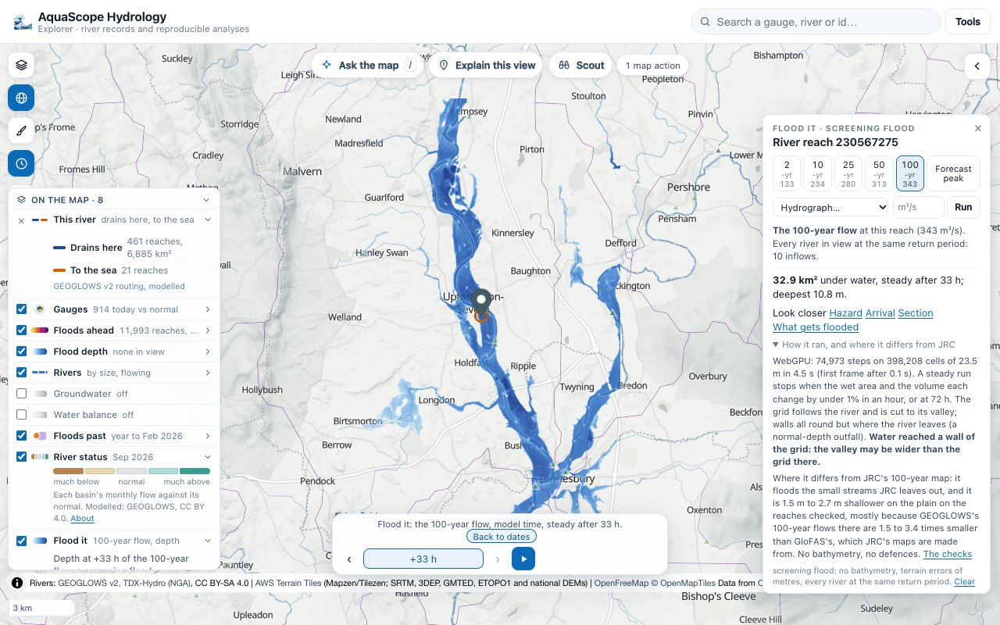

| | |
| --- | --- |
| 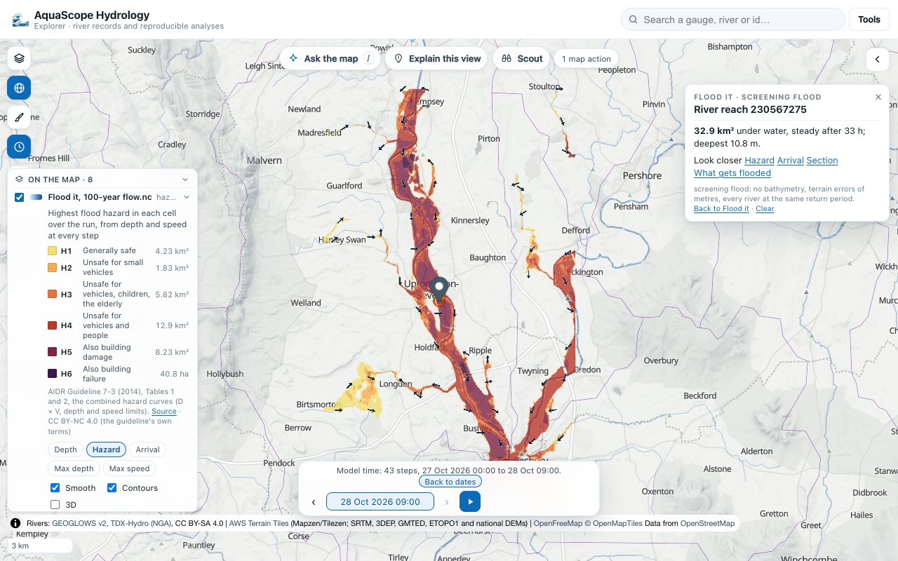 | 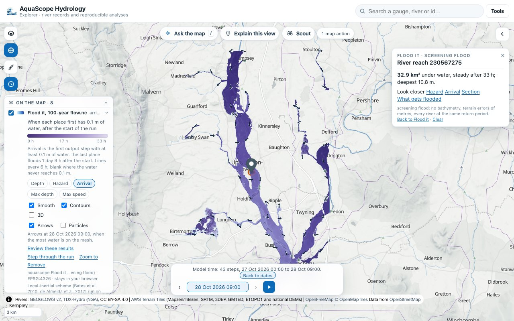 |
| 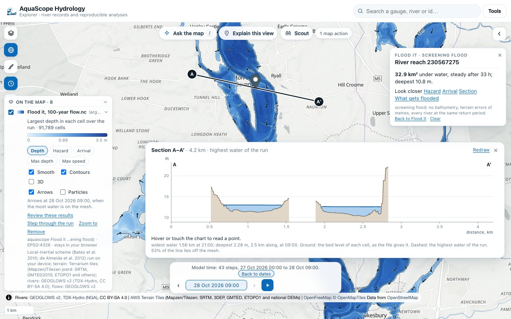 | 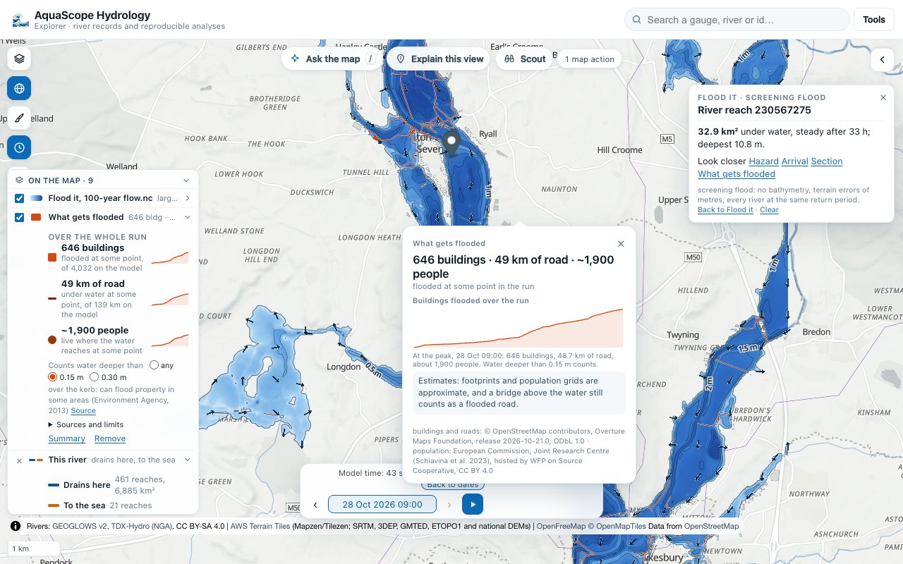 |
| 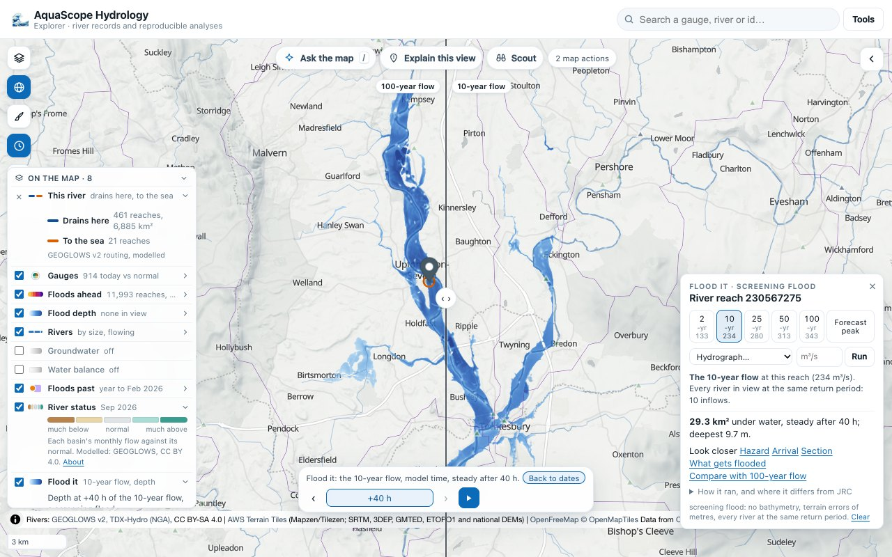 | 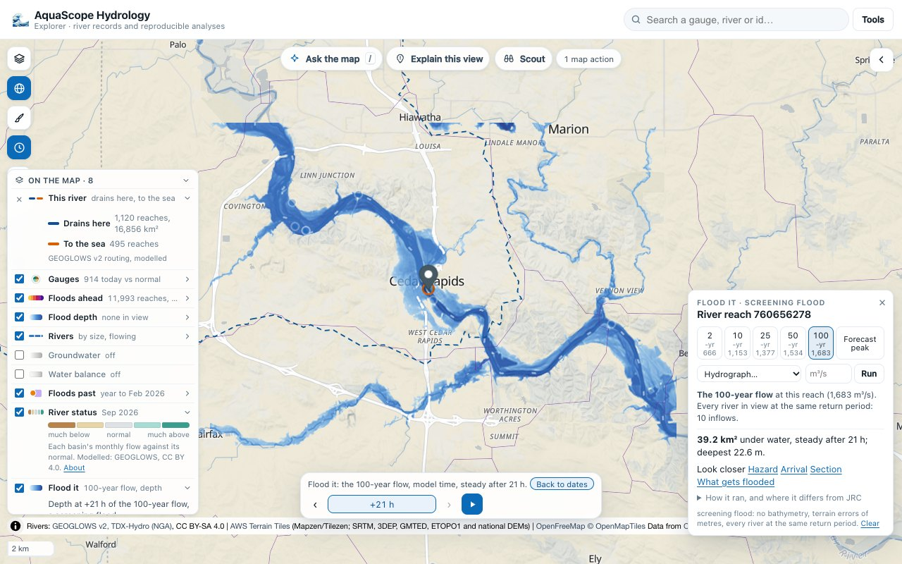 |

On a phone the panel is a sheet that folds to the answer after a run:

| | | | |
| --- | --- | --- | --- |
| 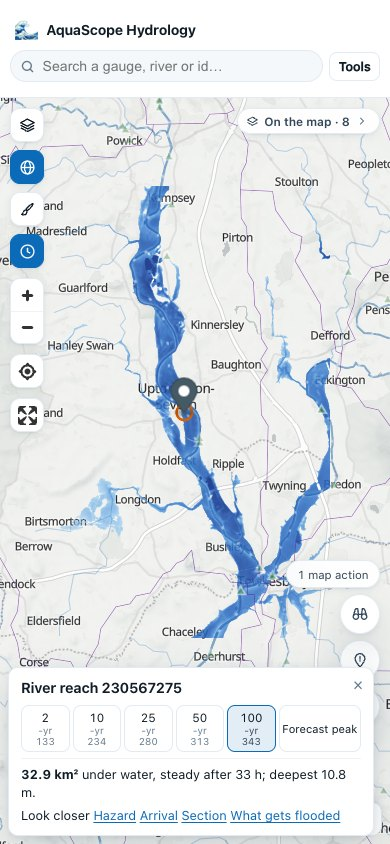 | 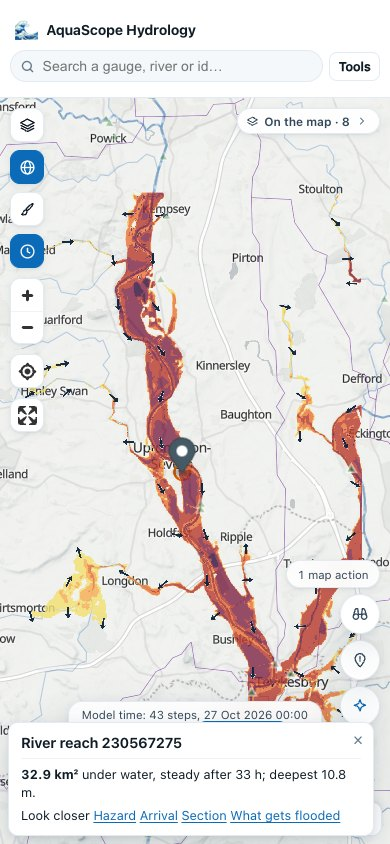 | 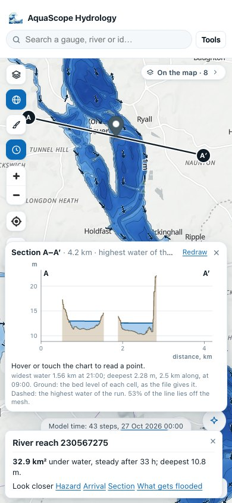 | 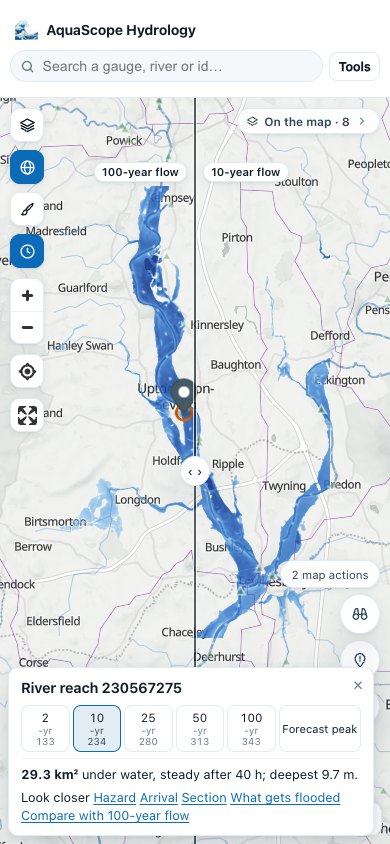 |

Without WebGPU the worker runs cells twice as large and says so:

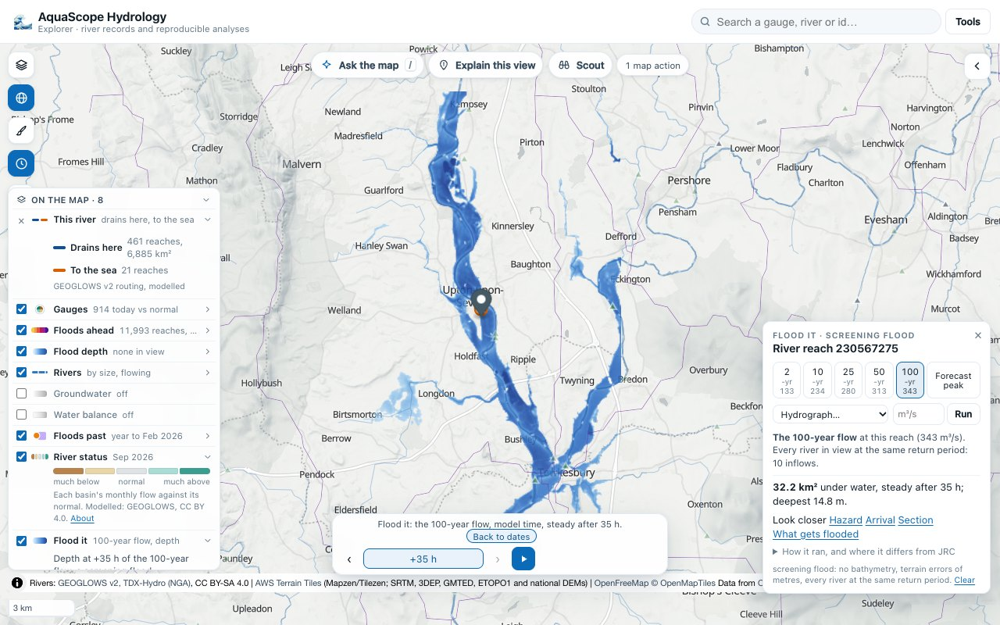

## What runs

### The grid follows the river

- **The corridor.** From the clicked reach, the main stem up (the branch with the largest catchment at each
  confluence) and down GEOGLOWS's own network (`rapid_connect`, the routing configuration Route it reads), 6 km of
  drawn river each way. The grid is the extent of that stem's line plus 3 km on every side, at zoom 12 of the
  Terrarium tiles (cells of about 24 m at 52°N, 38 m at the equator), at most 1,024 cells a side.
- **The valley.** The grid is then cut to the valley: the cells at most 10 m above the nearest big river (one whose
  100-year flow is at least a tenth of the clicked reach's), by straight-line distance, plus six cells. A valley still
  over 524,288 cells runs on cells twice as large.
- **The rivers.** Every GEOGLOWS reach drawn in the grid (the stream tiles at zoom 12, cut to their own tiles and
  joined end to end) is burnt in, one cell wide. Its line is first moved onto the lowest ground within two cells
  (GEOGLOWS's lines come from another terrain model, and in a winding valley they cross the spurs), joined to the reach
  below it, and made four-connected (water moves between cells through their faces only, so a diagonal step would be
  a dam). The bank is the terrain along the line made non-increasing downstream; the bed is the bank less the depth at
  which a wide channel one cell wide carries the reach's own 2-year flow at normal depth by Manning's equation,
  `d = (n Q2 / (W S^(1/2)))^(3/5)`, with `n = 0.035`, `W` the cell size and `S` the main stem's slope (the least-squares
  fall of its bank line, kept between 1e-4 and 1e-2). A cut is never more than 10 m into the ground beyond that depth.
- **Friction.** Manning's n of 0.035 in the channels and 0.06 on the flood plain: screening defaults within Chow's
  (1959) ranges, not calibrated.

### Every river in view is fed

A reach whose line crosses the grid's edge at its upstream end brings its own flow in there; a reach that starts inside
the grid takes the flow of each reach above it that is outside (or its own flow, when nothing is above it at all).
Reaches with a river above them in the grid get nothing more: that water arrives down the channel. So the Avon floods
at Tewkesbury, where the spike left it dry.

**The flows** are Log-Pearson III fits (`aquascope.hydrology.flood_frequency.fit_lp3`, the fit the reach card's
thresholds use) to GEOGLOWS v2's annual maxima of simulated daily flow, 1940 to 2024, read for every reach at once from
`retrospective/maximums.zarr` on AWS (a binary search over the store's sorted river ids, then one chunk of 500 reaches).
These are the same values as the yearly maxima of the API's daily record that the spike read reach by reach (checked on
reach 230567275: all 85 years agree; the 100-year flow is 343 m³/s from the store's 85 years and 341 m³/s from the API's
86). The store's own licence is CC BY-NC-SA 4.0.

**The same return period.** The flow chosen at the clicked reach is carried to every inflow at the same return period:
its return period on the clicked reach's curve, read in log(T) between the fitted points, gives each inflow's flow on
its own curve. Below the 2-year flow, and above the 500-year, each inflow gets the same share of its own 2-year (or
500-year) flow. A hydrograph is carried hour by hour the same way. Every river at its 100-year flow at once is more
water than any one flood brings to a confluence; JRC's maps, which run each river section on its own and keep the
deepest water, do not add them up either.

### The edges

Walls all round, but where a river leaves the grid: there a normal-depth outfall (`q = h^(5/3) S^(1/2) / n`, with the
main stem's slope) runs across the valley floor, along the edge cells no more than 10 m above the river's bank. An edge
cell below sea level is a free outfall. Where a river enters there is a wall with the inflow in the cell beside it. If
water stands at a wall away from the inflows, the panel says the valley may go on past the grid there.

### The run

The local-inertial approximation of the shallow water equations used by LISFLOOD-FP: Bates, Horritt and Fewtrell
(2010), *J. Hydrol.* 387, 33-45, doi:10.1016/j.jhydrol.2010.03.027, in the q-centred form of de Almeida, Bates,
Freer and Souvignet (2012), *Water Resour. Res.* 48, W05528, doi:10.1029/2011WR011570. Depth `h` and bed `z` sit
at cell centres, unit discharge `q` (m²/s) on the faces. One step:

```
hf      = max(eta_l, eta_r) - max(z_l, z_r)                       (eta = z + h)
q_new   = [theta q + (1 - theta)/2 (q_left + q_right) - g hf dt (eta_r - eta_l)/dx]
          / [1 + g dt n^2 |q| / hf^(7/3)]                         (0 where hf <= 1 mm)
h_new   = h + dt/dx (q_in - q_out)  summed over the four faces,  + Q(t) dt / dx^2 at each inflow cell
dt      = alpha dx / sqrt(g h_max)
```

with `alpha = 0.7` and `theta = 0.7` (de Almeida et al. 2012; de Almeida and Bates 2013, as given by Shaw et al.
2021, *GMD* 14, 3577, eqs. 18-19, and Cozzolino et al. 2019, *Adv. Water Resour.* 133, 103422, eqs. 46-48). A flux
limiter keeps every depth non-negative and the volume exact.

**The near steady state.** A constant flow runs until, at an hourly check, the wet area (deeper than 5 cm) and the
volume on the grid have each changed by under 1% since the last check, or to a cap: 72 hours of model time on the GPU,
48 on the worker. The cap is long enough for every reach checked below (the slowest, the Ahr, settled at 66 h), and a
run that meets it says so. A hydrograph runs to its end instead. Frames are kept every 15 minutes for three hours, then
hourly, and drawn as they come.

**Depths** on the map, in the panel and in the files are the water above the terrain the map is drawn from: the depth
over the burnt bed less the channel's cut. Off the channels the two are the same.

### One scheme, three implementations

| Where | What | Checked by |
| --- | --- | --- |
| `aquascope.floodsim` | numpy, float64: the plan, the grid, the CLI, MCP and the checks | `tests/test_floodsim.py` |
| `explorer/src/floodsim-core.js` | JS, float64: the fallback worker | `explorer/tests/floodsim-core.test.mjs` runs two Python fixtures (free edges and one inflow; walls, a normal-depth and a free outfall and two inflows, one a table): the same step counts, depths within 1 µm |
| `FLOODSIM_WGSL` in the same file | WebGPU compute shaders, f32, six passes a step, no read-back between steps | the second fixture on the GPU (Metal, headless Chrome): the same 1,485 steps and 176 wet cells, depths within 5.5 µm |

The worker in the Explorer plans and prepares the grid with the package (the main worker's `floodsim` op); the page
reads the terrain and runs the scheme. The run is handed to the flood views as a UGRID NetCDF-3 file of its wet cells
and a ring of dry ones (`ugridFile`, and `aquascope.floodsim.to_ugrid` writes the same file), which
`aquascope.io.mesh` reads like any model result.

## The checks

### Analytic

| Check | Result |
| --- | --- |
| Still water over a bumpy bed with dry islands, closed and open edges | no cell moves by more than 1e-12 m in 10 minutes |
| Volume budget (final = initial + inflow - outflow), closed and open | relative error under 1e-12 |
| Manning's normal depth on a 1/1000 plane, n = 0.05, q = 2 m²/s | within 2% mid-reach |
| A normal-depth outfall at the foot of that plane | passes the inflow within 1%, at Manning's depth within 2% |
| Ritter's (1892) dam break, 1 m on a dry, flat, frictionless bed, at 30 s | relative L1 depth error 0.18; the test allows 0.20 |

The dam break is the honest one: without the advection term the scheme cannot follow a supercritical front, and the
error does not shrink with the grid (de Almeida and Bates 2013). Floods on flood plains, which are slow, are what it is
for.

### Against JRC's 100-year depth, at four places

The JRC CEMS-GloFAS global river flood hazard map v2.1.2 (3 arc-seconds, CC BY 4.0, read from the Source Cooperative
mirror the Explorer's flood depth layer uses), sampled at each cell's centre (the nearest JRC pixel), against Flood it's
100-year run, steady, on the grid the Explorer builds for a click there. Wet is deeper than 5 cm; the burnt channel
cells are left out. CSI is the share of the cells wet in either that are wet in both; the hit rate the share of JRC's
wet cells Flood it wets; false alarms the share of Flood it's wet cells JRC leaves dry; the depth difference is Flood it
less JRC where both are wet.

| Reach (river_id) | Terrain | Grid | Inflows | CSI | Hit rate | False alarms | Depth difference, median (10th to 90th percentile) |
| --- | --- | --- | --- | --- | --- | --- | --- |
| Severn at Upton, with the Avon at Tewkesbury (230567275) | wide lowland valley, a confluence | 398,208 cells of 23.5 m | 10 | 0.715 | 0.866 | 0.196 | -1.57 m (-2.85 to -0.18) |
| Thames at Wallingford (230413886) | wide lowland valley | 299,754 cells of 23.7 m | 8 | 0.453 | 0.478 | 0.104 | -1.84 m (-3.47 to -0.38) |
| Ahr at Altenahr (230421547) | narrow, winding upland valley | 357,512 cells of 24.3 m | 7 | 0.431 | 0.557 | 0.345 | -0.46 m (-5.24 to 3.08) |
| Cedar River at Cedar Rapids, Iowa (760656278) | outside Europe, mid-western valley | 325,850 cells of 28.4 m | 10 | 0.651 | 0.785 | 0.207 | -2.75 m (-5.95 to 0.80) |

The spike's Severn run (one inflow) had CSI 0.645 on its grid; feeding the Avon, the grid that follows the river and
the channel fixes raise it to 0.715.

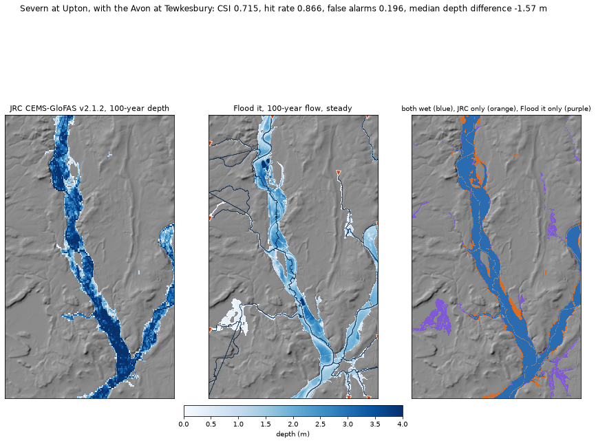
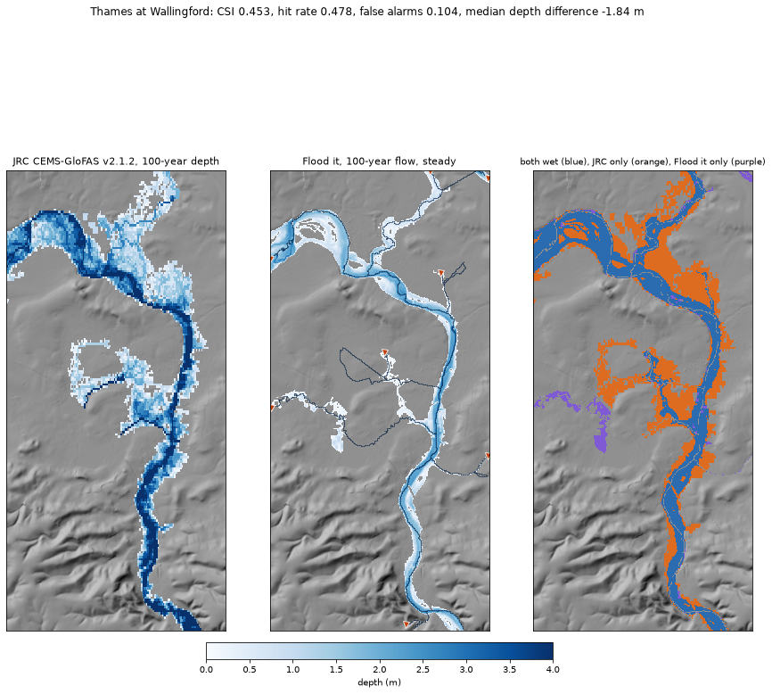
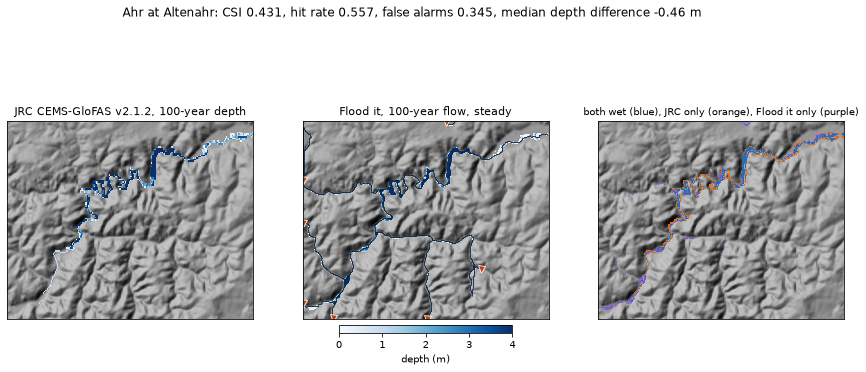
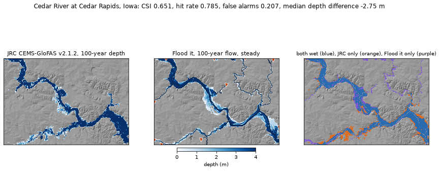

**Where Flood it differs from JRC** (the panel says this in short):

- **Small streams.** Most of Flood it's false alarms are along the small streams it feeds and JRC's map leaves dry.
- **Shallower.** Flood it is 0.5 m to 2.8 m shallower than JRC on the plain (median), and on the Thames it wets about
  half of JRC's extent.
- **Narrow upland valleys.** On the Ahr the water stays in a valley floor narrower than JRC's 90 m pixels, so the two
  overlap less there although the flood follows the same valley.

### Why Flood it is shallower

The spike found a median 1.6 m shallow bias on the Severn. What the checks show:

1. **Mostly the flow.** JRC's maps are made from GloFAS's flows (LISFLOOD). GloFAS v4's reanalysis at each site, read
   from the Open-Meteo flood API (the GloFAS cell with the largest mean flow within 0.05° of the reach) and fitted with
   the same Log-Pearson III, gives these 100-year flows for 1997 to 2025:

   | Site | GloFAS cell | GloFAS mean flow | GloFAS 100-year | GEOGLOWS 100-year (Flood it) | Ratio |
   | --- | --- | --- | --- | --- | --- |
   | Severn at Upton | 52.025°N 2.225°W | 63.7 m³/s | 954 m³/s | 343 m³/s | 2.8 |
   | Thames at Wallingford | 51.575°N 1.175°W | 27.6 m³/s | 613 m³/s | 261 m³/s | 2.3 |
   | Ahr at Altenahr | 50.525°N 7.025°E | 5.4 m³/s | 283 m³/s | 83 m³/s | 3.4 |
   | Cedar River at Cedar Rapids | 41.975°N 91.625°W | 178.5 m³/s | 2,518 m³/s | 1,683 m³/s | 1.5 |

   On the Severn the two models agree on the mean flow (GloFAS 63.7 m³/s, GEOGLOWS 58.8 m³/s at reach 230567275) but
   not on the floods. Scaling every inflow on the Severn by 1.5 brings the median difference from -1.57 m to -1.16 m;
   by 2.78 (GloFAS's 100-year flow over GEOGLOWS's) to -0.31 m, with the hit rate up to 0.953 (and false alarms up to
   0.305). These scaled runs are a diagnosis, not the method: Flood it keeps GEOGLOWS's flows, which are the Explorer's
   own everywhere else.
2. **Not the channel.** Taking the bank as the plain beside the river (the median of the ground two to four cells away)
   instead of the terrain on the line changed the Severn's median difference by under 0.01 m.
3. **The rest is unexplained.** JRC's own flood edges stand in water: the median depth on the edge of its extent is
   1.18 m on the Severn, 0.72 m on the Thames, 2.02 m on the Ahr and 1.61 m on the Cedar, where Flood it's edges taper to
   0.32 m, 0.18 m, 0.49 m and 0.61 m. That points at the ground under JRC's 90 m water being lower than the Terrarium
   terrain, or at how its depth is taken over it, but JRC's v2.1 method paper is described on the dataset page as in
   preparation, so this is not proven.

### The Portsmouth HEC-RAS sample

Not a like-for-like comparison, so none is reported. The sample the Explorer ships is a compound flood of a coastal
city (Zandsalimi, GNN4CF, HydroShare, CC BY 4.0): rain on every cell of a 6,272-cell mesh and a tidal water level at its
open boundary, on 30 June and 1 July 2021. Flood it floods river valleys from river inflows: it has no rain on the grid
and no water-level boundary, so the two would not be solving the same flood. The sample stays the reference for the
flood views themselves.

## Speed

Headless Chrome on an Apple M4 Max (WebGPU on Metal), other jobs running at the same time:

| Reach | Engine | Grid | Steady after (model time) | Wall time | Steps |
| --- | --- | --- | --- | --- | --- |
| Severn, in the Explorer | WebGPU | 398,208 cells of 23.5 m | 33 h | 4.5 s (first frame after 0.08 s) | 74,973 |
| Severn, in the Explorer | worker, no WebGPU | 99,552 cells of 47.0 m | 35 h | 60 s (first frame after 0.3 s) | 38,501 |
| Thames | WebGPU | 299,754 cells of 23.7 m | 27 h | 2.8 s | 56,690 |
| Ahr | WebGPU | 357,512 cells of 24.3 m | 66 h | 9.7 s | 187,379 |
| Cedar River | WebGPU | 325,850 cells of 28.4 m | 21 h | 2.7 s | 53,698 |

From the click to the settled flood takes about 30 seconds on the Severn, most of it the worker reading the network,
the flows and the stream tiles the first time; the terrain, the grid and the run take the rest. The worker runs cells
twice as large (a quarter of the cells) and caps a steady run at 48 hours; the panel says so.

## The three faces

- **The Explorer**: Flood it on a reach's card, the panel, the flood views and the swipe.
- **The CLI**: `aquascope flood RIVER_ID` (or `--at LAT LON`), with `--rp` (years), `--flow` (m³/s) or `--forecast`,
  `--hours` for the cap, and `--fine` for the GPU grid (by default the worker's, so numpy finishes in a few minutes).
  It writes the largest depth as a GeoTIFF (EPSG:3857), the run as a UGRID NetCDF that `aquascope mesh` and the
  Explorer's model viewer read, and a summary JSON.
- **MCP**: the tool `flood_reach`, the same arguments and summary, and the files with `out_dir`.
- **Ask the map**: the `flood_reach` action. The model picks the reach and the flow (a return period, a flow it was
  given, the forecast peak, the forecast or Route it's wave); the code computes the flood.

For levees and breaches (#663) the grid's terrain is one array (`prepare_grid`'s `z_burnt`): raising or lowering the
cells under a drawn line and running again is all a levee needs.

## Licences

Terrain: Terrarium tiles on AWS Open Data (Mapzen/Tilezen joerd: SRTM, GMTED2010, ETOPO1 and national models; see its
attribution list). Rivers: GEOGLOWS v2 (TDX-Hydro, NGA), CC BY-SA 4.0. Network: GEOGLOWS v2 routing configuration,
CC BY 4.0. Flows: GEOGLOWS v2 retrospective annual maxima, CC BY-NC-SA 4.0 (the store's own licence attribute); the
forecast, CC BY 4.0. JRC flood depth: CEMS-GloFAS v2.1.2, © European Union, CC BY 4.0, from N. Lebovits's Source
Cooperative mirror. GloFAS reanalysis for the bias check: through the Open-Meteo flood API (CC BY 4.0).
