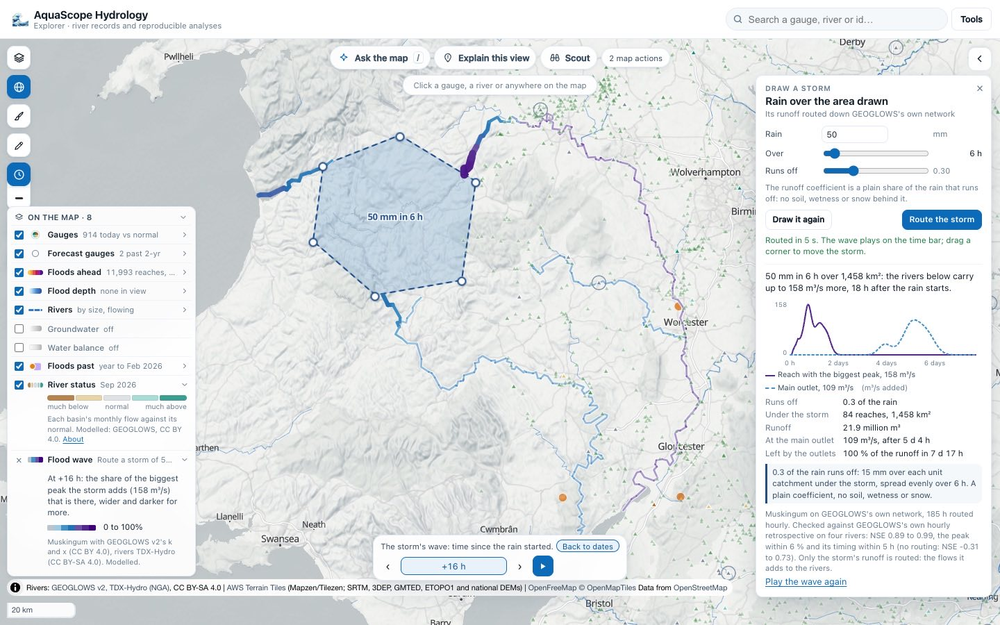
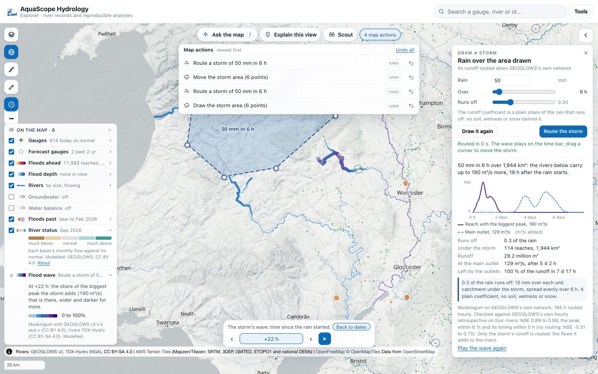
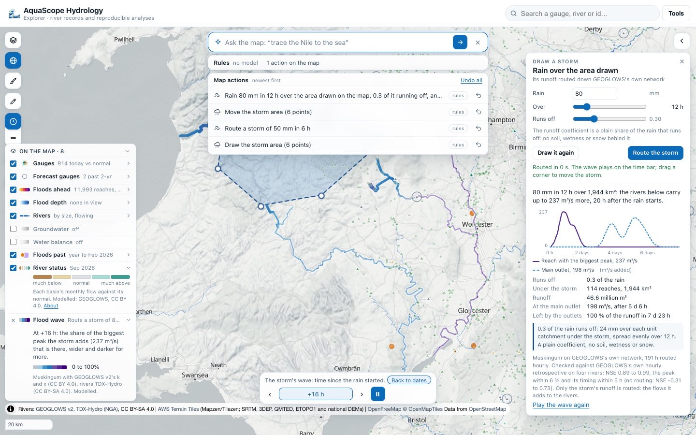
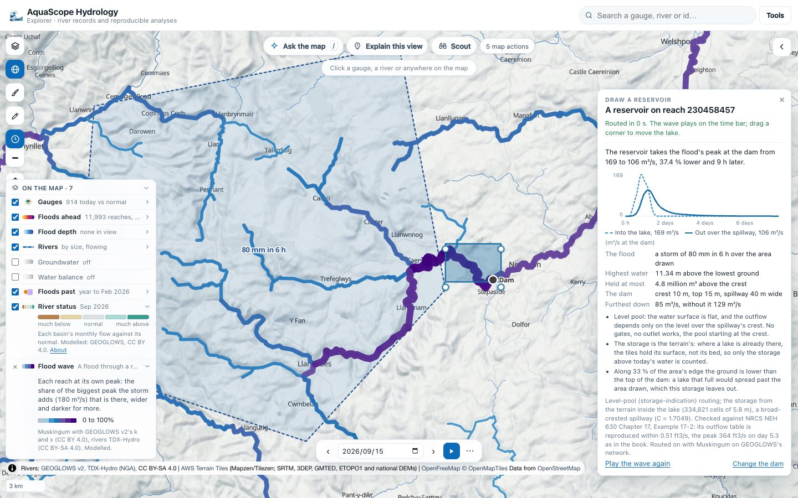
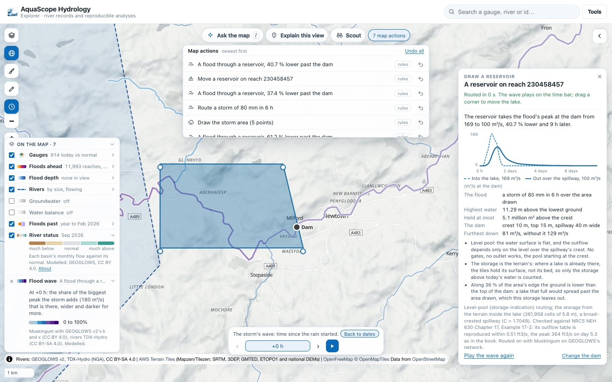

# The sketchpad: draw on the map and see it compute

The sketchpad is a short menu in the Explorer's map tools (the pencil under the brush). Each
tool draws something on the globe, runs a real computation in your browser on it, and draws
the answer back on the map: a wave travelling down the rivers, a flattened flood, a field of
contours. A small card holds the numbers, and on a phone it is a sheet at the bottom. Every
drawing and every run is an entry in the action log, with its undo. Nothing needs a key or a
server: the package runs in the page's worker (Pyodide), and the same functions are a CLI
verb and an MCP tool.

Part of [#664](https://github.com/Rekin226/aquascope/issues/664), "Make the map compute".
The modules are experimental (see [stability.md](stability.md)).

## Draw a storm

Draw an area, say how much rain falls on it and over how many hours, and watch the runoff
travel down every river below it ([#670](https://github.com/Rekin226/aquascope/issues/670)).

**Draw a storm** in the menu starts the drawing: tap the area's corners and press **Done**
(or Enter, or a double tap), or drag a box. The drawing tool is the one levees are drawn with
on Flood it's valley ([floodsim.md](floodsim.md#levees-and-breaches)), with an area instead of
a line.

The card then asks for three numbers:

- **Rain**, in mm over the area (above 0, at most 2,000).
- **Over**, the hours it falls over (1 to 72 here; the package takes up to 720).
- **Runs off**, the runoff coefficient: the share of the rain that runs off, 0.3 by default.
  It is said plainly on the card because it is plain: a single number, the same on every
  catchment, with no soil, no wetness before the storm and no snow behind it.

**Route the storm** runs `aquascope.routing.route_storm` in the worker, the same function as
`aquascope route storm` and the MCP tool `route_storm`:

1. Every GEOGLOWS v2 reach whose unit catchment's centre (GEOGLOWS's ERA5 weight table) falls
   inside the area gets the runoff coefficient times the rain over its own unit catchment,
   spread evenly over the hours.
2. That runoff is routed down every river below with Muskingum, GEOGLOWS's own k and x per
   reach, hour by hour, until the wave has passed the last reach (Route it's engine; see
   [Route a flood](explorer.md#route-a-flood) and its check against GEOGLOWS's own
   retrospective).

The wave plays on the rivers with the time bar's own clock (hours since the rain started),
coloured and widened by the share of the biggest peak the storm adds that is there at that
hour, through Route it's own layers. **Back to dates** shows every reach at its own peak. A
click on a reach opens its card: the wave's front, its peak and the hour of the peak.

The card says, all from the package:

- the biggest flow the storm adds anywhere and the hour it peaks;
- the hydrographs of the reach that gets the most and of the main outlet, hour by hour;
- how many reaches and km² are under the storm, the runoff in m³, and the main outlet's peak;
- **Left by the outlets**: the share of the runoff that has left by the outlets by the end of
  the hours routed, the run's own mass balance;
- the rule used, in words ("0.3 of the rain runs off: 15 mm over each unit catchment under the
  storm, spread evenly over 6 h. A plain coefficient, no soil, wetness or snow.").

**Drag a corner** of the area and the storm is routed again from where it is now. The move
and the new run are each in the action log; undo takes back the run, then the move.

### From words

Ask the map reads a storm without a model: "50 mm of rain over this area in 6 hours", "draw a
storm of 80 mm over 12 h", "rain 100 mm on Wales in 2 days with a runoff coefficient of 0.5",
"what if 120 mm of rain fell here". The action is `draw_storm` in `aquascope.map_commands`:
`rain_mm` (required), `duration_h` and `runoff_coefficient` (route_storm's own defaults, 6 h
and 0.3, when the words do not say), and the area: `area: "drawn"` ("this area", "here": the
area on the map, or the reader draws one), a `polygon`, a `bbox` or a `place` (its outline from
the gazetteer). A model may pick it; the package computes it.

On a phone the menu opens beside the tools, the card hides while the area is drawn, and after a
run it is a short sheet at the bottom over the time bar, with the area and the wave above it.

### The check

The routing is Route it's, checked against GEOGLOWS's own hourly retrospective on four rivers
(NSE 0.89 to 0.99, the peak within 6 % and its timing within 5 h; the table is in
[Route a flood](explorer.md#the-check-against-geoglowss-own-simulation)). What the storm adds
is checked by its water:

- **The runoff is the rain times the coefficient times the area.** Over mid-Wales (the area in
  the pictures), 50 mm and 0.3 over 84 reaches whose unit catchments add up to 1,457.6 km² is
  0.3 × 0.050 m × 1,457.6 km² = 21.9 million m³, the runoff the package reports.
- **All of it leaves.** Routed for 185 h, the outlets pass 21.9 million m³: 100 % of the
  runoff (Muskingum keeps mass; `tests/test_routing.py` checks the same on a small network to
  1 %).

The runoff coefficient is not a model of the soil, and the routing is the flow the storm adds
to whatever the rivers already carry: modelled, for the shape and the timing of a wave, not a
forecast.

### The CLI and MCP

    aquascope route storm --polygon '[[-3.78,52.62],[-3.45,52.70],[-3.12,52.58],[-3.18,52.32],[-3.55,52.28],[-3.82,52.42]]' --rain 50 --duration 6 --runoff 0.3

prints the same message; `--json` adds every number, the hydrographs and the mass balance. The
MCP tool `route_storm` returns the same as JSON.

## Draw a reservoir

Draw a lake across a river, set the dam, and watch it flatten a flood on its way down
([#662](https://github.com/Rekin226/aquascope/issues/662)).

**Draw a reservoir** in the menu starts the same drawing tool: tap the lake's corners and
press **Done**, or drag a box. The worker finds the river and the dam
(`aquascope.sketch.reservoir.plan`):

- every GEOGLOWS reach whose line has a point inside the lake is in it (the stream tiles at
  zoom 12, where every reach is drawn);
- the river is the biggest of them (the highest Strahler order), and the dam is at its exit:
  the reach the most of the lake drains through, at the point of its line inside the lake
  nearest the reach below.

The page then reads the terrain under the lake from the Terrarium tiles (the same reader as
Flood it, at the finest zoom up to 14 that keeps the window to a million cells;
`Access-Control-Allow-Origin: *`, checked live), and the worker turns it into the lake's
stage-area and stage-storage curves (`stage_storage`): at each level above the lowest ground,
the cells below it and the volume `sum(level - ground)` over them. So yes, the terrain tiles
give a stage-area curve from the drawn area, and that is the storage used. Two limits are said
on the card: where a lake already exists the tiles hold its surface, not its bed, so only the
storage above today's water counts; and where the ground at the lake's edge is lower than the
top of the dam, a full lake would spread past the area drawn, which this storage leaves out
(the card gives the share of the edge).

The card asks for the dam:

- **Crest**, the spillway's crest in m above the lowest ground: the pool starts there (full to
  the crest, the usual flood-routing start).
- **Top**, the top of the dam in m above the lowest ground: a flood that rises above it is said
  to overtop it.
- **Spillway**, its width in m. The outflow is a broad-crested weir, `Q = C b H^1.5` with
  `C = (2/3)^1.5 g^0.5`, about 1.705 in SI (critical depth over the crest, the ideal weir of
  the open-channel texts; `aquascope.floodsim.WEIR_C`, the one Flood it's breaches use).

These start at 10 m, 15 m and 30 m: illustrative, for you to set.

And the flood:

- **the T-year flow here**: the dam's reach's 2-, 10-, 25- or 100-year flow (GEV on its GEOGLOWS
  simulated record), a triangle over 24 hours, entering at the dam;
- **a number** in m³/s;
- **the wave on the map**: a Route it flood from a reach upstream, or a drawn storm
  ([Draw a storm](#draw-a-storm)), routed down to the dam.

**Route it through** runs `route_reservoir`: Route it's Muskingum down GEOGLOWS's network, with
the dam's reach's outflow passed through the reservoir (`routing.route_network`'s `through`)
before it goes on. The wave on the time bar is the flattened one past the dam. The same run is
made without the reservoir, so the card says how much lower the peak is furthest down.

The card says, all from the package: the peak into the lake and out over the spillway, how much
lower and how much later; the highest water above the lowest ground (and whether it overtops
the dam); the most held above the crest; the peak furthest down with the reservoir and without
it; and the two hydrographs at the dam, hour by hour.

**Drag a corner** of the lake: the river and the terrain are found again, and after a run the
flood is routed through it again. The lake and every run are in the action log, each undoable.

### From words

Ask the map reads a reservoir without a model: "draw a reservoir here", "draw a reservoir with a
40 m spillway at 12 m", "put a dam here and route the 100-year flood through it", "draw a
reservoir and send the wave through it". The action is `draw_reservoir` in
`aquascope.map_commands`: the lake (`area: "drawn"` or a `polygon`), `crest_m`, `top_m`,
`width_m` and the flood (`return_period`, `peak_cms`, or `inflow: "wave"`, the wave on the map).

On a phone the card is the same short sheet at the bottom, with the lake and the dam above it. Reading
the terrain and routing took about 32 s in headless Chrome the first time (the terrain is then kept,
and a second run on the same lake took under a second).

### The check

The method is checked against a textbook example: USDA NRCS, *National Engineering Handbook*,
Part 630 Hydrology, Chapter 17 "Flood Routing" (210-VI-NEH, Amend. 69, April 2014), Example
17-2, the storage-indication routing of a principal spillway hydrograph through a floodwater
retarding structure ([the chapter, a public PDF](https://directives.nrcs.usda.gov/sites/default/files2/1712930622/21209.pdf)).
`level_pool` takes the book's working curve (Table 17-11, p. 17-22: discharge in ft³/s against
storage above the first-stage crest in ft³/s-days) and its inflow (Table 17-12, p. 17-24), with
the book's own steps (0.5 day, 0.1 day from 4.5 to 6.0 days, then 0.5 day), from an empty pool.
Every outflow of Table 17-12 is reproduced within 0.51 ft³/s (the book rounds each step to a
whole ft³/s), and the peak is 364.2 ft³/s on day 5.3; the book's peak is 364 ft³/s on days 5.3
and 5.4. Some of the rows:

| Day | Inflow (ft³/s) | Book (ft³/s) | Here (ft³/s) |
| ---: | ---: | ---: | ---: |
| 4.5 | 245 | 115 | 115.5 |
| 5.0 | 2,002 | 212 | 212.5 |
| 5.1 | 1,049 | 358 | 358.2 |
| 5.3 | 393 | 364 | 364.2 |
| 6.0 | 164 | 355 | 354.9 |
| 6.5 | 138 | 249 | 249.2 |
| 10.0 | 67 | 120 | 120.2 |

`aquascope route reservoir --check` prints the whole table, and
`tests/test_sketch_reservoir.py` holds it to 1 ft³/s. Two more checks are in the tests: with a
linear reservoir (`S = K O`) the method is exactly the trapezoidal recursion
`O2 = ((2K - dt) O1 + dt (I1 + I2)) / (2K + dt)`; and the terrain's storage is the area times the
depth for a flat floor, and the V-shaped valley's width at each level.

### The CLI and MCP

    aquascope route reservoir --polygon '[[-3.40,52.505],[-3.34,52.505],[-3.34,52.53],[-3.40,52.53]]' --crest 10 --top 15 --width 40 --rp 100

reads the terrain tiles itself and prints the reservoir's numbers and the peak furthest down with
and without it (`--peak`, `--from RIVER_ID`, `--storm RING --rain MM`, `--json`); `--check`
prints the NEH table. The MCP tool `route_reservoir` returns the same as JSON.

GEOGLOWS v2 routing configuration and retrospective, CC BY 4.0; river network TDX-Hydro (NGA), CC BY-SA 4.0,
shown and not republished. Terrain: Terrarium tiles (Mapzen/Tilezen joerd on AWS Open Data: SRTM, GMTED2010,
ETOPO1, national lidar and others; each tile names its sources).
