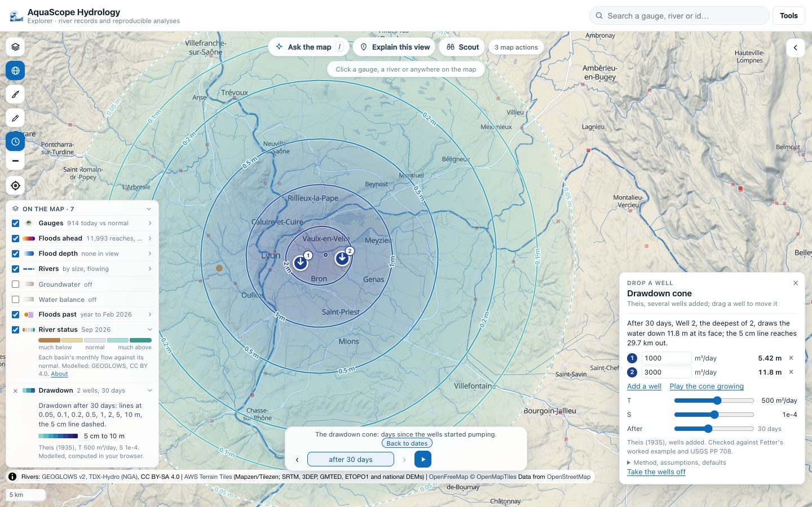
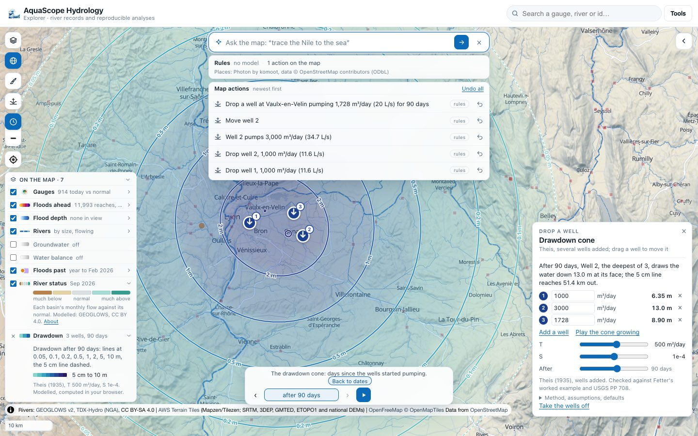
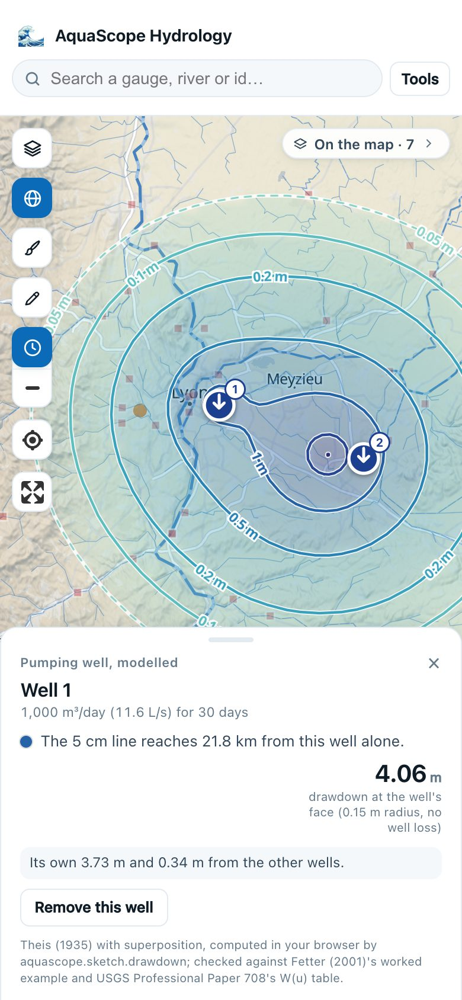

# The sketchpad: draw on the map and see it compute

The sketchpad is a short menu in the Explorer's map tools (the pencil under the brush). Each
tool draws something on the globe, runs a real computation in your browser on it, and draws
the answer back on the map: a wave travelling down the rivers, a flattened flood, a field of
contours. A small card holds the numbers, and on a phone it is a sheet at the bottom. Every
drawing and every run is an entry in the action log, with its undo. Nothing needs a key or a
server: the package runs in the page's worker (Pyodide), and the same functions are a CLI
verb and an MCP tool.

Part of [#664](https://github.com/Rekin226/aquascope/issues/664), "Make the map compute".
The modules are experimental (see [stability.md](stability.md)).

## Draw a storm

Draw an area, say how much rain falls on it and over how many hours, and watch the runoff
travel down every river below it ([#670](https://github.com/Rekin226/aquascope/issues/670)).


**Draw a storm** in the menu starts the drawing: tap the area's corners and press **Done**
(or Enter, or a double tap), or drag a box. The drawing tool is the one levees are drawn with
on Flood it's valley ([floodsim.md](floodsim.md#levees-and-breaches)), with an area instead of
a line.


The card then asks for three numbers:

- **Rain**, in mm over the area (above 0, at most 2,000).
- **Over**, the hours it falls over (1 to 72 here; the package takes up to 720).
- **Runs off**, the runoff coefficient: the share of the rain that runs off, 0.3 by default.
  It is said plainly on the card because it is plain: a single number, the same on every
  catchment, with no soil, no wetness before the storm and no snow behind it.

**Route the storm** runs `aquascope.routing.route_storm` in the worker, the same function as
`aquascope route storm` and the MCP tool `route_storm`:

1. Every GEOGLOWS v2 reach whose unit catchment's centre (GEOGLOWS's ERA5 weight table) falls
   inside the area gets the runoff coefficient times the rain over its own unit catchment,
   spread evenly over the hours.
2. That runoff is routed down every river below with Muskingum, GEOGLOWS's own k and x per
   reach, hour by hour, until the wave has passed the last reach (Route it's engine; see
   [Route a flood](explorer.md#route-a-flood) and its check against GEOGLOWS's own
   retrospective).


The wave plays on the rivers with the time bar's own clock (hours since the rain started),
coloured and widened by the share of the biggest peak the storm adds that is there at that
hour, through Route it's own layers. **Back to dates** shows every reach at its own peak. A
click on a reach opens its card: the wave's front, its peak and the hour of the peak.

The card says, all from the package:

- the biggest flow the storm adds anywhere and the hour it peaks;
- the hydrographs of the reach that gets the most and of the main outlet, hour by hour;
- how many reaches and km² are under the storm, the runoff in m³, and the main outlet's peak;
- **Left by the outlets**: the share of the runoff that has left by the outlets by the end of
  the hours routed, the run's own mass balance;
- the rule used, in words ("0.3 of the rain runs off: 15 mm over each unit catchment under the
  storm, spread evenly over 6 h. A plain coefficient, no soil, wetness or snow.").

**Drag a corner** of the area and the storm is routed again from where it is now. The move
and the new run are each in the action log; undo takes back the run, then the move.


### From words

Ask the map reads a storm without a model: "50 mm of rain over this area in 6 hours", "draw a
storm of 80 mm over 12 h", "rain 100 mm on Wales in 2 days with a runoff coefficient of 0.5",
"what if 120 mm of rain fell here". The action is `draw_storm` in `aquascope.map_commands`:
`rain_mm` (required), `duration_h` and `runoff_coefficient` (route_storm's own defaults, 6 h
and 0.3, when the words do not say), and the area: `area: "drawn"` ("this area", "here": the
area on the map, or the reader draws one), a `polygon`, a `bbox` or a `place` (its outline from
the gazetteer). A model may pick it; the package computes it.


On a phone the menu opens beside the tools, the card hides while the area is drawn, and after a
run it is a short sheet at the bottom over the time bar, with the area and the wave above it.


### The check

The routing is Route it's, checked against GEOGLOWS's own hourly retrospective on four rivers
(NSE 0.89 to 0.99, the peak within 6 % and its timing within 5 h; the table is in
[Route a flood](explorer.md#the-check-against-geoglowss-own-simulation)). What the storm adds
is checked by its water:

- **The runoff is the rain times the coefficient times the area.** Over mid-Wales (the area in
  the pictures), 50 mm and 0.3 over 84 reaches whose unit catchments add up to 1,457.6 km² is
  0.3 × 0.050 m × 1,457.6 km² = 21.9 million m³, the runoff the package reports.
- **All of it leaves.** Routed for 185 h, the outlets pass 21.9 million m³: 100 % of the
  runoff (Muskingum keeps mass; `tests/test_routing.py` checks the same on a small network to
  1 %).

The runoff coefficient is not a model of the soil, and the routing is the flow the storm adds
to whatever the rivers already carry: modelled, for the shape and the timing of a wave, not a
forecast.

### The CLI and MCP

    aquascope route storm --polygon '[[-3.78,52.62],[-3.45,52.70],[-3.12,52.58],[-3.18,52.32],[-3.55,52.28],[-3.82,52.42]]' --rain 50 --duration 6 --runoff 0.3

prints the same message; `--json` adds every number, the hydrographs and the mass balance. The
MCP tool `route_storm` returns the same as JSON.

GEOGLOWS v2 routing configuration, CC BY 4.0; river network TDX-Hydro (NGA), CC BY-SA 4.0,
shown and not republished.

## Drop a well

"What happens to the water table if I pump here?" **Drop a well** in the sketchpad's menu, then a click on the map, drops a pumping
well there. Its drawdown cone is drawn round it: contour lines at 5 cm (dashed, the cone's edge), 10 cm, 20 cm,
0.5 m, 1, 2, 5 m and deeper, over a fill that darkens with depth. Drop more wells and their cones add. Drag a well and
the cone follows as you drag; change a well's rate, the aquifer's transmissivity and storativity, or the days of
pumping, and it is computed again. **Play the cone growing** takes the time bar and plays the cone from 6 hours to the
days you chose.

A well's card gives its drawdown at its face (at the well's radius, 0.15 m by default, with no well loss), its own
share and what the other wells add there, and how far its 5 cm line reaches. A contour's card gives the drawdown
where you clicked and the nearest well. On a phone the panel is a sheet at the bottom, and a card takes its place
while it is open.




**With your MODFLOW model.** When MODFLOW heads are on the map ([MODFLOW heads on the map](modflow.md)) and a well is
dropped inside the model, its card names the model's cell under it, the cell's size and the layer shown, and what the
model's well cell would read instead of the well's own drawdown: the Theis drawdown at Peaceman's equivalent radius,
0.2 times the cell's side (Peaceman, 1978). A coarse cell averages the steep part of the cone; the card says by how
much.


### The model

Theis (1935): the drawdown at a distance `r` from a well pumping `Q` for a time `t` in a confined aquifer of
transmissivity `T` and storativity `S` is

```
s = Q / (4 π T) · W(u),    u = r² S / (4 T t),    W(u) = E1(u)
```

Several wells add by superposition. The well function is `aquascope.groundwater.aquifer`'s, the engine behind
`aquascope groundwater --analysis theis` and the `aquifer_drawdown` tool, so there is one Theis in the package. The
cone is traced by marching squares on a grid that is even across the cone and closes in on every well geometrically,
so the tight circles near a well are as true as the wide ones far out. Distances are measured on a local plane around
the wells. The cone is cut 100 km from the wells.

**What it assumes**, and the panel says so: a confined aquifer, homogeneous, isotropic and of infinite extent; wells
that fully penetrate it and pump at a constant rate; water released from storage at once. No recharge, no rivers or
boundaries, no leakage, no delayed yield of a water table. A screening answer, not a well-field design.

**The defaults** are a municipal well in a confined sand aquifer: 1,000 m³/day (11.6 L/s), T = 500 m²/day,
S = 1e-4, read after 30 days. The typical ranges are from Heath (1983), USGS Water-Supply Paper 2220: the
transmissivity of principal aquifers ranges from less than 1 to 100,000 m²/day (p. 26), and the storage coefficient of
most confined aquifers from about 1e-5 to 1e-3 (p. 28). The panel's sliders reach past them, and say so when you do.

### The check

`aquascope well --check` recomputes these, and `tests/test_sketch_drawdown.py` holds them:

| Reference | Printed | Computed |
| --- | --- | --- |
| Fetter (2001), *Applied Hydrogeology*, 4th ed., the worked example of the Theis equation: K = 14.9 m/day over 20.1 m (T = 299 m²/day as printed), S = 0.0051, Q = 2725 m³/day, r = 7.0 m, t = 1 day | u = 0.00021, W(u) = 7.94, drawdown 5.7 m | u = 0.000209, drawdown 5.73 m |
| Lohman (1972), *Ground-water hydraulics*, USGS Professional Paper 708, Table 5, p. 16: W(u) for u = N × 10ᵏ, rows N = 1.0 and N = 2.0, k from -15 to 0 (32 values) | four decimals | every value within 1e-4 |
| Superposition: two equal wells 1 km apart | equal at mirror points, the same both ways | 2.4021 / 2.4021 m; 1.1290 / 1.1290 m |

Fetter reads W(u) from the table at u = 2 × 10⁻⁴ (7.94) where the inputs give u = 2.09 × 10⁻⁴ (W = 7.90); the book's
5.7 m and the code's 5.73 m agree to the two figures printed. PP 708 is at
<https://pubs.usgs.gov/pp/0708/report.pdf>; the superposition check also confirms that the wells pumped together give
the wells pumped alone, added.

### From words, a CLI and an agent

Ask the map reads "drop a well here", "drop a well at Lyon pumping 2000 m3/day" and "drill a borehole near Lille
pumping 20 l/s for 90 days" into the `drop_well` action without a model (a rate in L/s is turned into m³/day); the
place is looked up and the map computes the cone. The same function from a terminal and for an agent:

```bash
aquascope well --at 4.88 45.76 --at 4.92 45.765 --rate 1000 --rate 3000 --days 90 --geojson cone.geojson
aquascope well --check
```



The MCP tool `drop_well` takes one well (`lon`, `lat`, `rate_m3_day`) or `wells`, and returns the same numbers and the
contours in lon/lat.



### References

- Theis, C.V. (1935). The relation between the lowering of the piezometric surface and the rate and duration of
  discharge of a well using ground-water storage. *Transactions, American Geophysical Union*, 16, 519-524.
- Fetter, C.W. (2001). *Applied Hydrogeology*, 4th edition. Prentice Hall.
- Lohman, S.W. (1972). *Ground-water hydraulics*. USGS Professional Paper 708.
- Heath, R.C. (1983). *Basic ground-water hydrology*. USGS Water-Supply Paper 2220.
- Peaceman, D.W. (1978). Interpretation of well-block pressures in numerical reservoir simulation. *SPE Journal*,
  18(3), 183-194. doi:10.2118/6893-PA.
